   
  
    
  <h1 align="center"><b>Ryan Alves</b></h1>
  
<b>Estudante do 6º período de Engenharia de Software | Co-fundador na ecodex</b>

  

    
  

   

---

### Sobre Mim

Sou estudante de **Engenharia de Software (6º período)** e cofundador na **ecodex**. Atuo com foco principal em **diagnóstico preciso e resolução de problemas complexos** mapeando gargalos operacionais, investigando falhas de processos e estruturando a arquitetura ideal de solução.

Atualmente, aprofundo a minha especialização em **Engenharia de Dados e Inteligência Artificial**, conectando a visão estratégica de negócio à automação, fluxos de dados com Databricks, PySpark e SQL, e desenvolvimento de software.

---

### Tecnologias & Ferramentas

#### Engenharia de Software & Desenvolvimento

  
  
  
  
  
  
  
  

#### Dados, IA & Banco de Dados

  
  
  
  
  
  

---

### Atuação & Entregas na ecodex

- **Diagnóstico & Estratégia de Negócio:** Mapeamento de processos e identificação de onde a operação perde tempo ou recursos antes de escolher qualquer ferramenta.
- **Liderança Técnica & Arquitetura:** Direcionamento técnico de projetos, alinhando a visão de negócio à execução de software limpo e escalável.
- **Engenharia de Dados & IA:** Estruturação de pipelines no Databricks/PySpark, automações e integração de modelos de IA aplicados a problemas reais da operação.
